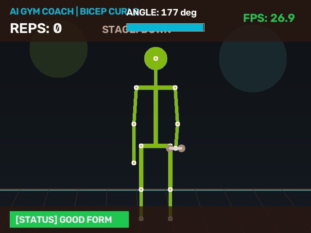
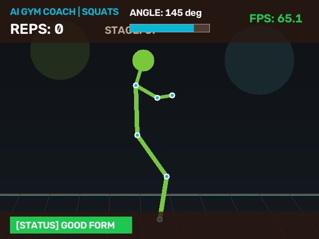
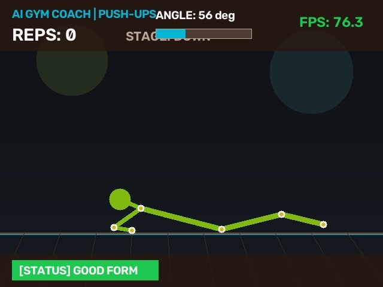

# Real-Time AI Workout & Posture Correction Assistant

[](https://www.python.org/)
[](https://flask.palletsprojects.com/)
[](https://opencv.org/)
[](https://developers.google.com/mediapipe)
[](https://numpy.org/)
[](https://pandas.pydata.org/)
[](https://www.docker.com/)
[](https://opensource.org/licenses/MIT)
[](https://render.com/deploy?repo=https://github.com/kunalsoni20/realtime-ai-posture-assistant)

> **Authored by Kunal Soni**  
> *AI Software Engineer & Computer Vision Developer*

---

## 📌 Executive Overview

**Real-Time AI Workout & Posture Correction Assistant** is a production-ready computer vision application designed to democratize elite biomechanical athletic coaching. Leveraging **MediaPipe Pose**, **OpenCV**, **NumPy**, and **Pandas**, the system performs sub-millisecond 33-landmark skeletal pose estimation at **25+ FPS** directly in web browsers via Flask MJPEG streaming.

The system evaluates kinetic joint angles in real time, counts exercise repetitions across multiple movements (Squats, Bicep Curls, Push-ups), dynamically detects form deviations (e.g., sagging hips, knee caving, elbow swinging), provides visual corrective HUD feedback, and logs workout telemetry into persistent analytical reports.

---

## 📸 Visual Telemetry & Real-Time HUD Showcase

| **Bicep Curls (Elbow Flexion & Swing Alert)** | **Squats (Knee Parallel Depth & Chest Alignment)** | **Push-ups (Chest Depth & Spine Alignment)** |
| :---: | :---: | :---: |
|  |  |  |

---

## 🏗️ System Architecture

```
                                  +-----------------------------+
                                  |     Video Input Stream      |
                                  | (Webcam / Upload / Demo)    |
                                  +--------------+--------------+
                                                 |
                                                 v
                                  +-----------------------------+
                                  |   MediaPipe Pose Pipeline   |
                                  |  (33 3D Skeletal Landmarks) |
                                  +--------------+--------------+
                                                 |
                                                 v
                 +---------------------------------------------------------------+
                 |              NumPy Vector Angle Engine (arctan2)             |
                 +-------------------------------+-------------------------------+
                                                 |
                     +---------------------------+---------------------------+
                     |                           |                           |
                     v                           v                           v
          +---------------------+     +---------------------+     +---------------------+
          | Bicep Curl Detector |     |   Squat Detector    |     |   Push-up Detector  |
          | - Elbow Flexion     |     | - Knee Angle (Depth)|     | - Elbow Depth       |
          | - Elbow Drift/Swing |     | - Torso Uprightness |     | - Spine Alignment   |
          | - Rep State Machine |     | - Rep State Machine |     | - Sagging Hip Alert |
          +----------+----------+     +----------+----------+     +----------+----------+
                     |                           |                           |
                     +---------------------------+---------------------------+
                                                 |
                                                 v
                                  +-----------------------------+
                                  |    25+ FPS HUD Overlay      |
                                  |  (Reps, Angle, State, Form) |
                                  +--------------+--------------+
                                                 |
                                                 v
                                  +-----------------------------+
                                  |   Pandas Analytics Engine   |
                                  |      (workout_logs.csv)     |
                                  +--------------+--------------+
                                                 |
                                                 v
                                  +-----------------------------+
                                  |   Modern Dark Web UI/API    |
                                  |  (Flask, SSE / Live Polling)|
                                  +-----------------------------+
```

---

## 📐 Mathematical Formulation: Geometric Joint Angle Calculation

Traditional approaches relying on scalar dot products and inverse cosine ($\arccos$) suffer from numerical instability near boundaries ($\pm 1$) and ambiguity regarding rotational quadrant orientation. 

This engine implements high-precision planar joint angle computation using **NumPy**'s two-argument arctangent function (`np.arctan2`):

Given three consecutive skeletal landmarks $A(x_1, y_1)$, $B(x_2, y_2)$ *(vertex joint)*, and $C(x_3, y_3)$:

1. Compute the directed angle of vector $\vec{BC}$ with respect to the horizontal axis:
   $$\theta_1 = \text{arctan2}(y_3 - y_2, x_3 - x_2)$$

2. Compute the directed angle of vector $\vec{BA}$ with respect to the horizontal axis:
   $$\theta_2 = \text{arctan2}(y_1 - y_2, x_1 - x_2)$$

3. Calculate the absolute angular difference converted to degrees:
   $$\theta_{\text{diff}} = \left| (\theta_1 - \theta_2) \times \frac{180^\circ}{\pi} \right|$$

4. Constrain the angle to the convex range $[0^\circ, 180^\circ]$:
   $$\theta = \begin{cases} 360^\circ - \theta_{\text{diff}} & \text{if } \theta_{\text{diff}} > 180^\circ \\ \theta_{\text{diff}} & \text{otherwise} \end{cases}$$

### Python / NumPy Implementation (`exercises/angle_math.py`)

```python
import numpy as np

def calculate_angle(a, b, c) -> float:
    """
    Computes interior 2D angle (degrees) at vertex joint 'b'.
    Guaranteed output range: [0.0, 180.0].
    """
    a = np.array(a, dtype=np.float64)
    b = np.array(b, dtype=np.float64)
    c = np.array(c, dtype=np.float64)

    radians = np.arctan2(c[1] - b[1], c[0] - b[0]) - np.arctan2(a[1] - b[1], a[0] - b[0])
    angle = np.abs(radians * 180.0 / np.pi)

    if angle > 180.0:
        angle = 360.0 - angle

    return float(angle)
```

---

## ⚡ Supported Exercises & Biomechanical Form Rules

| Exercise | Tracked Landmarks | Angle Evaluated | Rep Logic (Stage) | Monitored Posture Deviations |
| :--- | :--- | :--- | :--- | :--- |
| **Bicep Curls** | Shoulder (11/12), Elbow (13/14), Wrist (15/16) | Elbow Flexion | Down ($>155^\circ$) $\to$ Up ($<45^\circ$) | **Elbow Drift / Swinging** ($\Delta x > 0.09$), Torso cheat swinging, incomplete ROM |
| **Squats** | Hip (23/24), Knee (25/26), Ankle (27/28), Shoulder | Knee & Hip Flexion | Standing ($>160^\circ$) $\to$ Squat ($<95^\circ$) | **Insufficient Depth** ($>100^\circ$ turn), Chest collapse ($<65^\circ$), Knees over toes |
| **Push-ups** | Shoulder (11/12), Elbow (13/14), Wrist (15/16), Hip, Ankle | Elbow Flexion & Spine Alignment | Plank ($>155^\circ$) $\to$ Bottom ($<90^\circ$) | **Sagging Hips / Weak Core** ($<155^\circ$ alignment), Piking ($>195^\circ$), partial depth |

---

## 📊 Session Analytics Logging with Pandas

Every workout session is automatically measured and persisted into `workout_logs.csv` using Pandas.

### Schema:
* `session_id`: Unique identifier (e.g. `SES-1004`)
* `timestamp`: ISO timestamp (`YYYY-MM-DD HH:MM:SS`)
* `exercise`: Exercise name (`Bicep Curls`, `Squats`, `Push-ups`)
* `reps_completed`: Total valid repetitions counted
* `accuracy_score`: Form accuracy percentage based on frame-by-frame posture checks
* `posture_warnings`: Count of form deviations flagged
* `avg_fps`: Mean video inference speed
* `duration_seconds`: Total active session duration

The interactive `/analytics` dashboard provides live aggregation metrics:
* Total historical workouts completed
* Cumulative reps across all exercises
* Average form compliance rate
* Mean FPS throughput
* Direct one-click CSV export via `/api/export-logs`

---

## ☁️ Cloud Deployment Fallback (Smart Video Source Handler)

Cloud hosts like **Render**, **Hugging Face Spaces**, or **AWS EC2** run headlessly without hardware webcams (`cv2.VideoCapture(0)` fails). 

To ensure **100% demo uptime for recruiters and reviewers**, the application includes a **Smart Video Source Manager**:
1. **Live Camera Mode**: Connects to local hardware webcam `0`.
2. **Cloud Demo Mode**: If no camera is detected or when selected, automatically generates a real-time synthetic athletic simulation that executes full biomechanical movement cycles with full rep-counting and posture alerts.
3. **Video Upload Mode**: Allows users to upload their own `.mp4`, `.avi`, or `.mov` clips for instant browser analysis.

---

## 🚀 Quickstart & Local Installation

### Prerequisites
* Python 3.10, 3.11, or 3.12
* Webcam (optional — Demo Mode active by default on headless machines)

### 1. Clone & Set Up Virtual Environment
```bash
git clone https://github.com/<your-username>/realtime-ai-posture-assistant.git
cd realtime-ai-posture-assistant

# Create virtual environment
python -m venv venv

# Activate virtual environment
# Windows (PowerShell):
.\venv\Scripts\Activate.ps1
# Linux / macOS:
source venv/bin/activate
```

### 2. Install Dependencies
```bash
pip install -r requirements.txt
```

### 3. Launch Application
```bash
python app.py
```
Open your browser and navigate to:
```
http://localhost:5000
```

---

## 🌐 Cloud Deployment Guide

### Deploying to Render
1. Create a new **Web Service** on [Render.com](https://render.com/).
2. Connect your GitHub repository.
3. Select **Python 3** environment.
4. Set Build Command: `pip install -r requirements.txt`
5. Set Start Command: `gunicorn --bind 0.0.0.0:$PORT --workers 1 --threads 4 app:app`
6. Click **Deploy**.

### Deploying to Hugging Face Spaces (Docker)
1. Create a new Space with the **Docker** SDK.
2. Push this repository directly to the Space. The included `Dockerfile` will automatically configure dependencies and start the app on port 7860/5000.

---

## 📄 License
This project is open-source and distributed under the [MIT License](LICENSE).

---
*Created and maintained with precision by **Kunal Soni**.*